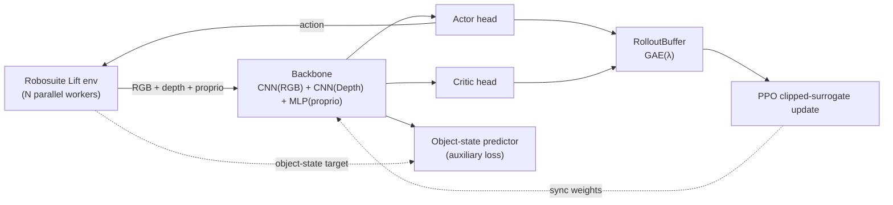

# Physically informed reinforcement learning

[](https://github.com/eljandoubi/Physically-Informed-Reinforcement-Learning/actions/workflows/ci.yml)
[](LICENSE)

Proximal Policy Optimization (PPO) for robotic manipulation in [Robosuite](https://robosuite.ai/). An agent controls a Panda arm on the `Lift` task from RGB, depth and proprioceptive observations.

A shared visual-proprioceptive backbone is also trained to predict the object's physical state as an auxiliary objective. This keeps the representation grounded in the physics of the scene, even though the policy never observes `object-state` directly.

## Results

No success rate is reported yet. Training logs progress to the console and records completed episodes locally. Weights & Biases tracking is optional.

## How to run

### Requirements

- Python 3.11 or newer.
- [uv](https://github.com/astral-sh/uv) for dependency management.
- [`just`](https://github.com/casey/just) as a task runner (optional, recommended).
- A MuJoCo-compatible offscreen rendering backend to run the simulation (training and video rendering, not the unit tests). Set `MUJOCO_GL` to `egl` on a machine with an NVIDIA GPU, or to `osmesa` for CPU-only software rendering, which needs the `libosmesa6-dev` system package on Debian or Ubuntu.
- A [Weights & Biases](https://wandb.ai/) login only when `--use_wandb` is enabled. Put the API key in a local `.env` file or the environment.

### Install

```bash
git clone https://github.com/eljandoubi/Physically-Informed-Reinforcement-Learning.git
cd Physically-Informed-Reinforcement-Learning
just setup
```

`just setup` creates a `.venv` with uv and installs every dependency pinned in [`uv.lock`](uv.lock): PyTorch, Robosuite, MuJoCo, wandb and the `dev` group used for linting and testing. It also installs the `pirl` package in editable mode, which provides the `pirl-train` and `pirl-video` console scripts used below.

### Train

```bash
just train
# equivalent to: uv run pirl-train
```

Checkpoints are written to `ppo_checkpoints/<run-id>/`, or `ppo_checkpoints/default_run/` without a run ID. `episodes.jsonl` in that directory records the environment index, total environment steps and whether the task succeeded at any point in each completed episode. Enable Weights & Biases with `--use_wandb`.

### Render a video

Once a run has a saved checkpoint, render the best policy:

```bash
just video <run_id>
# equivalent to: uv run pirl-video --runid <run_id>
```

The video is saved under `ppo_videos/<run_id>/`.

### Clean up

```bash
just clean   # removes checkpoints, videos, caches, and .venv
```

### Configuration

Every hyperparameter lives in the `TrainingConfig` dataclass in [`pirl/ppo.py`](pirl/ppo.py) and is exposed as a CLI flag through [`simple-parsing`](https://github.com/lebrice/SimpleParsing), for example:

```bash
uv run pirl-train --num_envs 8 --gamma 0.995 --max_training_timesteps 500000
```

The most commonly tuned options:

| Flag | Default | Description |
| --- | --- | --- |
| `--num_envs` | `12` | Parallel Robosuite worker processes. |
| `--max_ep_len` | `256` | Max timesteps per episode (also the rollout length per env). |
| `--max_training_timesteps` | `1000000` | Total environment steps before training stops. |
| `--K_epochs` | `100` | Optimization epochs per PPO update. |
| `--gamma` / `--lam` | `0.99` / `0.95` | Discount factor and GAE λ. |
| `--fixed_policy_variance` | `True` | Fixed vs. learned action distribution variance. |
| `--use_object_obs` | `True` | Enable the auxiliary object-state prediction loss. |
| `--img_size` | `64` | RGB/depth observation resolution fed to the CNNs. |
| `--load_checkpoint_path` | `None` | Resume training from a saved checkpoint. |
| `--use_wandb` | `False` | Enable Weights & Biases tracking. |
| `--runid` | `None` | Resume/attach to an existing Weights & Biases run. |

Run `uv run pirl-train --help` for the full list, generated from the dataclass.

## Design choices



- A CNN on RGB, a CNN on depth and an MLP on proprioceptive state are fused into one embedding. The actor, the critic and the auxiliary object-state predictor share it.
- PPO uses a clipped surrogate objective and generalized advantage estimation (GAE(λ)). It has separate learning rates for the backbone, actor, critic and predictor, a fixed or learned action variance, and gradient clipping.
- `SubprocVecEnv` runs `N` Robosuite workers in parallel. It detects, rebuilds and recovers from crashed worker processes instead of taking down the whole training run.
- Weights & Biases can track runs with resume support. The best and latest policies are checkpointed whether tracking is enabled or not.
- `pirl-video` renders a multi-camera mosaic (front, bird, agent, side, robot and eye-in-hand views) of a trained policy to an `.mp4`.
- Tooling is uv for dependencies, a `justfile` task runner, ruff for lint and format, a pytest suite and GitHub Actions CI. `pirl/` is an installable Python package.

| File | Description |
| --- | --- |
| [`pirl/model.py`](pirl/model.py) | `Backbone` and `ActorCritic` networks: RGB and depth CNNs plus a proprioceptive MLP fused into actor, critic and object-state prediction heads. |
| [`pirl/ppo.py`](pirl/ppo.py) | `TrainingConfig` (validated dataclass of hyperparameters) and the `PPO` agent: action sampling, the clipped-surrogate update loop, and checkpoint save and load. |
| [`pirl/ppo_train.py`](pirl/ppo_train.py) | Training entrypoint (`pirl-train`): wires up the vectorized environment, PPO agent, rollout buffer and Weights & Biases logging. |
| [`pirl/robotenv.py`](pirl/robotenv.py) | `make_env` and `get_env_infos` helpers, and `SubprocVecEnv`, a self-healing vectorized environment wrapper. |
| [`pirl/rollout.py`](pirl/rollout.py) | `RolloutBuffer`: stores trajectories and computes GAE(λ) advantages and returns. |
| [`pirl/video.py`](pirl/video.py) | Renders an evaluation rollout of a trained policy to a multi-camera `.mp4` (`pirl-video`). |
| [`tests/`](tests/) | `pytest` suite covering the network, buffer, and PPO and config logic. |
| [`justfile`](justfile) | Task runner: setup, train, render video, lint, format, test. |
| [`.github/workflows/ci.yml`](.github/workflows/ci.yml) | GitHub Actions: lint and format check, then the test suite. |

## Status and limits

- No success rate is reported yet.
- The `pytest` suite in [`tests/`](tests) covers the parts that are pure PyTorch or Python. They run deterministically in a few seconds, without a GPU, a display or a MuJoCo rendering backend:
  - [`test_model.py`](tests/test_model.py): `Backbone` and `ActorCritic` output shapes, fixed vs. learned action variance, and the object-state prediction head.
  - [`test_rollout.py`](tests/test_rollout.py): `RolloutBuffer` storage, overflow handling, and the GAE(λ) math, checked against hand-computed values including done-flag bootstrap masking.
  - [`test_ppo.py`](tests/test_ppo.py): `TrainingConfig` validation and the `PPO` agent's action selection, update step and checkpoint save and load round trip.
  - [`test_robotenv.py`](tests/test_robotenv.py): the pure observation-conversion helpers (`filter_state`, `stack_obs`).
- Live Robosuite and MuJoCo environment creation and rendering (`make_env`, `SubprocVecEnv` end to end, `video_render`) are not covered by this unit suite. They need a real rendering backend and several seconds of simulator startup, which is a poor fit for CI. Verify them by hand with `just train` and `just video` on a machine with a working `MUJOCO_GL` backend.
- Every push and pull request to `master` runs two CI jobs (see [`.github/workflows/ci.yml`](.github/workflows/ci.yml)). The first is `ruff check` and `ruff format --check`, run on their own so that PyTorch and Robosuite need not be installed just to lint. The second is `uv sync` followed by the full `pytest` suite with coverage reporting.

## Development

All common tasks are available through the `justfile`:

```bash
just lint          # ruff check .
just lint-fix       # ruff check --fix .
just format         # ruff format .
just format-check   # ruff format --check .
just test           # pytest
just test-cov        # pytest --cov --cov-report=term-missing
just check          # lint + format-check + test (what CI runs)
```

Run `just setup` for a working environment and `just check` before a pull request. It is exactly what CI runs.

## License

Distributed under the MIT License. See [`LICENSE`](LICENSE) for details.

Built on [Robosuite](https://robosuite.ai/) and [MuJoCo](https://mujoco.org/) for the simulation, [PyTorch](https://pytorch.org/) for the models, [Weights & Biases](https://wandb.ai/) for tracking, and [uv](https://github.com/astral-sh/uv) and [Ruff](https://github.com/astral-sh/ruff) for tooling.
