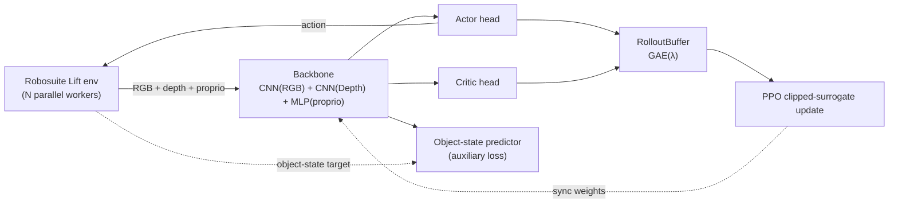

# PIRL — Physically Informed Reinforcement Learning

**Proximal Policy Optimization for multimodal robotic manipulation in [Robosuite](https://robosuite.ai/).**

An agent controls a Panda arm on the `Lift` task using RGB, depth and proprioceptive
observations. A shared visual-proprioceptive backbone is additionally trained to
*predict* the object's physical state as an auxiliary objective, encouraging the
representation to stay grounded in the scene's physics even though the policy never
observes `object-state` directly.

[](https://github.com/eljandoubi/Physically-Informed-Reinforcement-Learning/actions/workflows/ci.yml)
[](LICENSE)
[](pyproject.toml)
[](https://github.com/astral-sh/uv)
[](https://github.com/astral-sh/ruff)

## Table of Contents

- [Features](#features)
- [Architecture](#architecture)
- [Project Structure](#project-structure)
- [Requirements](#requirements)
- [Getting Started](#getting-started)
- [Usage](#usage)
- [Configuration](#configuration)
- [Development](#development)
- [Testing Strategy](#testing-strategy)
- [Continuous Integration](#continuous-integration)
- [Contributing](#contributing)
- [License](#license)
- [Acknowledgments](#acknowledgments)

## Features

- **Multimodal perception** — a CNN + CNN + MLP backbone fuses RGB, depth, and
  proprioceptive state into a single embedding shared by the actor, critic, and an
  auxiliary object-state predictor.
- **PPO with GAE(λ)** — clipped surrogate objective, generalized advantage
  estimation, per-component learning rates (backbone/actor/critic/predictor), fixed
  or learned action variance, and gradient clipping.
- **Resilient vectorized environments** — `SubprocVecEnv` runs `N` Robosuite workers
  in parallel and automatically detects, rebuilds, and recovers from crashed
  worker processes instead of taking down the whole training run.
- **Experiment tracking** — Weights & Biases integration with run-resume support and
  automatic checkpointing of the best and latest policies.
- **Evaluation video rendering** — renders a multi-camera mosaic (front/bird/agent/
  side/robot/eye-in-hand views) of a trained policy to an `.mp4`.
- **Reproducible tooling** — [uv](https://github.com/astral-sh/uv)-managed
  dependencies, a `justfile` task runner, `ruff` lint/format, a `pytest` suite, and
  GitHub Actions CI.
- **Real installable package** — `pirl/` is a proper Python package (`pip`/`uv`
  installable) exposing `pirl-train` and `pirl-video` console scripts.

## Architecture



## Project Structure

| File | Description |
| --- | --- |
| [`pirl/model.py`](pirl/model.py) | `Backbone` and `ActorCritic` networks: RGB/depth CNNs + proprioceptive MLP fused into actor, critic, and object-state prediction heads. |
| [`pirl/ppo.py`](pirl/ppo.py) | `TrainingConfig` (validated dataclass of hyperparameters) and the `PPO` agent: action sampling, the clipped-surrogate update loop, and checkpoint save/load. |
| [`pirl/ppo_train.py`](pirl/ppo_train.py) | Training entrypoint (`pirl-train`): wires up the vectorized environment, PPO agent, rollout buffer, and Weights & Biases logging. |
| [`pirl/robotenv.py`](pirl/robotenv.py) | `make_env`/`get_env_infos` helpers and `SubprocVecEnv`, a self-healing vectorized environment wrapper. |
| [`pirl/rollout.py`](pirl/rollout.py) | `RolloutBuffer`: stores trajectories and computes GAE(λ) advantages/returns. |
| [`pirl/video.py`](pirl/video.py) | Renders an evaluation rollout of a trained policy to a multi-camera `.mp4` (`pirl-video`). |
| [`tests/`](tests/) | `pytest` suite covering the network, buffer, and PPO/config logic. |
| [`justfile`](justfile) | Task runner: setup, train, render video, lint, format, test. |
| [`.github/workflows/ci.yml`](.github/workflows/ci.yml) | GitHub Actions: lint + format check, then the test suite. |

## Requirements

- Python 3.10+
- [uv](https://github.com/astral-sh/uv) for dependency management
- [`just`](https://github.com/casey/just) (optional but recommended task runner)
- A MuJoCo-compatible offscreen rendering backend for actually running the
  simulation (training/video rendering, not the unit tests): set `MUJOCO_GL` to
  `egl` on a machine with an NVIDIA GPU, or `osmesa` for CPU-only software
  rendering (requires the `libosmesa6-dev` system package on Debian/Ubuntu).
- A [Weights & Biases](https://wandb.ai/) account if you want to log/resume runs
  (optional — put your API key in a local `.env` file, e.g. `WANDB_API_KEY=...`).

## Getting Started

```bash
git clone https://github.com/eljandoubi/Physically-Informed-Reinforcement-Learning.git
cd Physically-Informed-Reinforcement-Learning
just setup
```

`just setup` creates a `.venv` with [uv](https://github.com/astral-sh/uv), installs
every dependency pinned in [`uv.lock`](uv.lock) (PyTorch, Robosuite, MuJoCo, wandb,
plus the `dev` group used for linting and testing), and installs the `pirl`
package itself in editable mode — exposing the `pirl-train`/`pirl-video` console
scripts used below.

## Usage

### Train

```bash
just train
# equivalent to: uv run pirl-train
```

Checkpoints are written to `ppo_checkpoints/<wandb-run-id>/`, and progress is logged
to the console (and to Weights & Biases, if configured).

### Render a video

Once you have a run with a saved checkpoint, render the best policy:

```bash
just video <run_id>
# equivalent to: uv run pirl-video --runid <run_id>
```

The video is saved under `ppo_videos/<run_id>/`.

### Clean up

```bash
just clean   # removes checkpoints, videos, caches, and .venv
```

## Configuration

Every hyperparameter lives in the `TrainingConfig` dataclass in [`pirl/ppo.py`](pirl/ppo.py)
and is automatically exposed as a CLI flag (via
[`simple-parsing`](https://github.com/lebrice/SimpleParsing)), for example:

```bash
uv run pirl-train --num_envs 8 --gamma 0.995 --max_training_timesteps 500000
```

Some of the most commonly tuned options:

| Flag | Default | Description |
| --- | --- | --- |
| `--num_envs` | `12` | Parallel Robosuite worker processes. |
| `--max_ep_len` | `256` | Max timesteps per episode (also the rollout length per env). |
| `--max_training_timesteps` | `1000000` | Total environment steps before training stops. |
| `--K_epochs` | `100` | Optimization epochs per PPO update. |
| `--gamma` / `--lam` | `0.99` / `0.95` | Discount factor and GAE λ. |
| `--fixed_policy_variance` | `True` | Fixed vs. learned action distribution variance. |
| `--use_object_obs` | `True` | Enable the auxiliary object-state prediction loss. |
| `--img_size` | `64` | RGB/depth observation resolution fed to the CNNs. |
| `--load_checkpoint_path` | `None` | Resume training from a saved checkpoint. |
| `--runid` | `None` | Resume/attach to an existing Weights & Biases run. |

Run `uv run pirl-train --help` for the full, auto-generated list.

## Development

All common tasks are available through the `justfile`:

```bash
just lint          # ruff check .
just lint-fix       # ruff check --fix .
just format         # ruff format .
just format-check   # ruff format --check .
just test           # pytest
just test-cov        # pytest --cov --cov-report=term-missing
just check          # lint + format-check + test (what CI runs)
```

## Testing Strategy

The `pytest` suite in [`tests/`](tests) focuses on the parts of the codebase that
are pure PyTorch/Python and can run deterministically in a few seconds, without a
GPU, display, or MuJoCo rendering backend:

- [`test_model.py`](tests/test_model.py) — `Backbone`/`ActorCritic` output shapes,
  fixed vs. learned action variance, and the object-state prediction head.
- [`test_rollout.py`](tests/test_rollout.py) — `RolloutBuffer` storage, overflow
  handling, and GAE(λ) math (verified against hand-computed expected values,
  including done-flag bootstrap masking).
- [`test_ppo.py`](tests/test_ppo.py) — `TrainingConfig` validation and the `PPO`
  agent's action selection, update step, and checkpoint save/load round-trip.
- [`test_robotenv.py`](tests/test_robotenv.py) — the pure observation-conversion
  helpers (`filter_state`, `stack_obs`).

Live Robosuite/MuJoCo environment creation and rendering (`make_env`,
`SubprocVecEnv` end-to-end, `video_render`) are intentionally **not** covered by
this fast unit suite — they require a real rendering backend and multi-second
simulator startup, which isn't a good fit for CI. Verify those manually with
`just train` / `just video` on a machine with a working `MUJOCO_GL` backend.

## Continuous Integration

Every push and pull request to `master` runs two jobs (see
[`.github/workflows/ci.yml`](.github/workflows/ci.yml)):

1. **Lint & format** — `ruff check` and `ruff format --check`, run standalone (no
   need to install PyTorch/Robosuite just to lint).
2. **Test** — `uv sync` followed by the full `pytest` suite with coverage
   reporting.

## Contributing

1. Run `just setup` to get a working environment.
2. Make your changes.
3. Run `just check` (lint + format check + tests) before opening a PR — this is
   exactly what CI runs.

## License

Distributed under the MIT License. See [`LICENSE`](LICENSE) for details.

## Acknowledgments

- [Robosuite](https://robosuite.ai/) and [MuJoCo](https://mujoco.org/) for the
  simulation environment.
- [PyTorch](https://pytorch.org/) for the modeling stack.
- [Weights & Biases](https://wandb.ai/) for experiment tracking.
- [uv](https://github.com/astral-sh/uv) and [Ruff](https://github.com/astral-sh/ruff)
  for project tooling.
